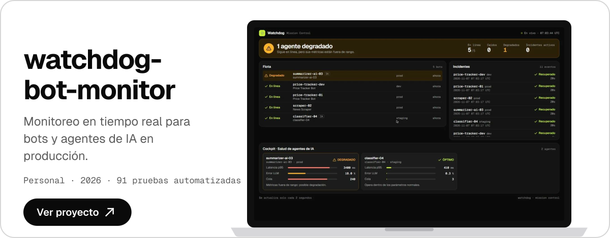
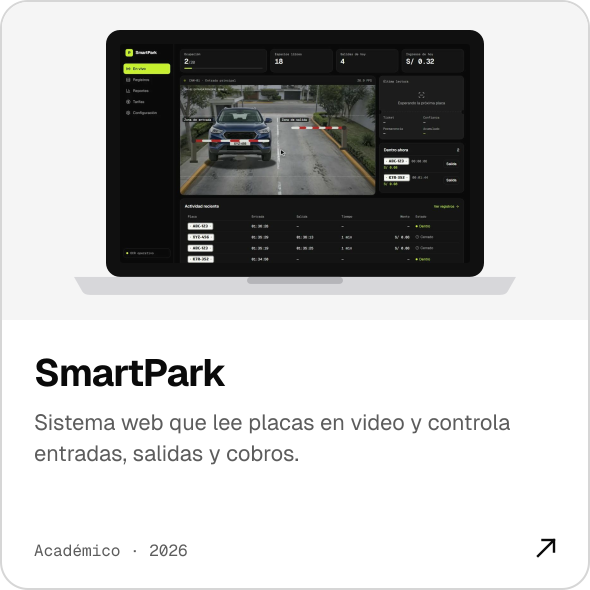
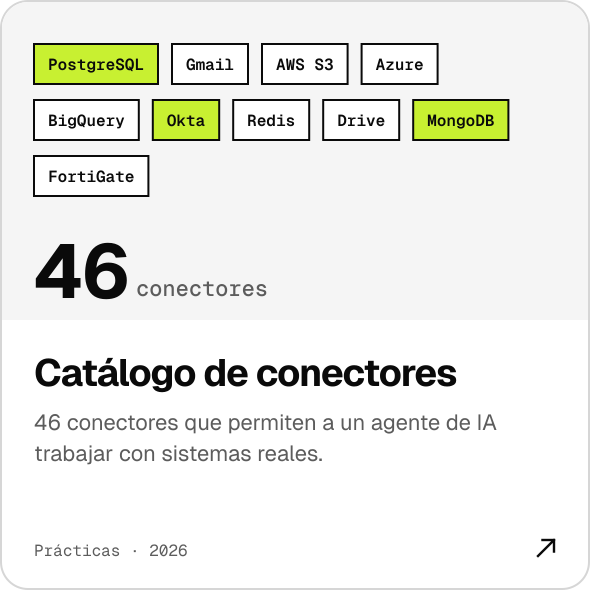
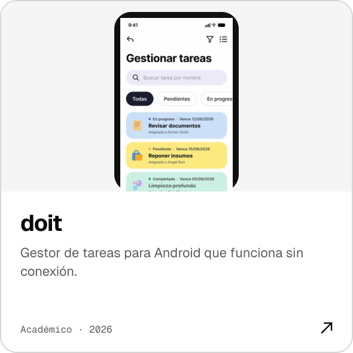
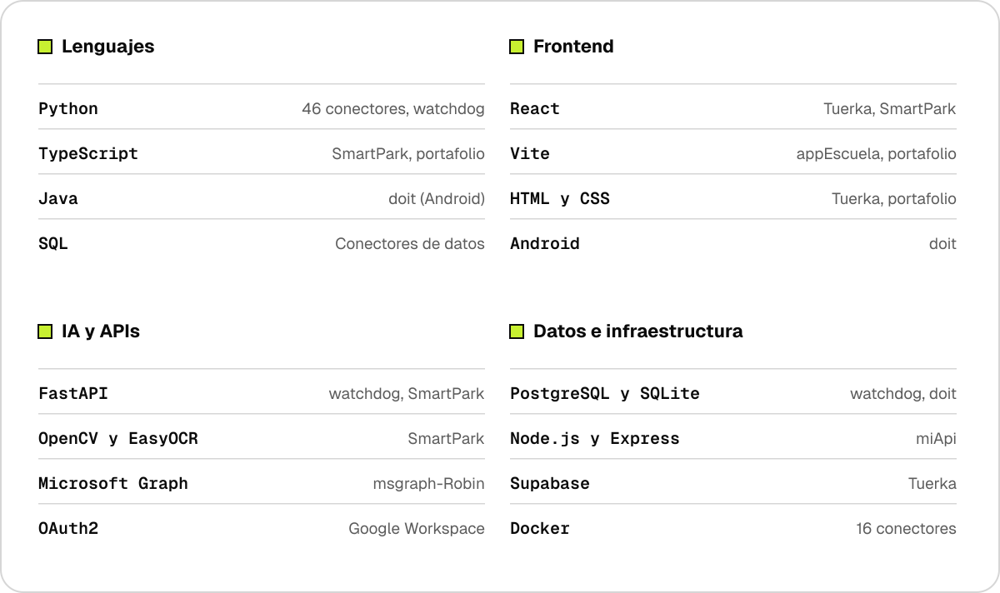
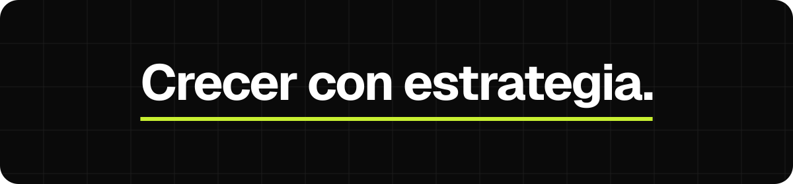

  &nbsp;
  &nbsp;
  

Estudio el 5.º ciclo de Ingeniería de Software con IA en SENATI. Trabajo con Python, TypeScript y React, y construyo conectores que llevan agentes de IA a sistemas reales.

Me interesa entender cómo funciona el código por dentro y convertir procesos manuales en flujos automáticos.

## Proyectos.

  
  

  
  

## Stack, con evidencia.

 

